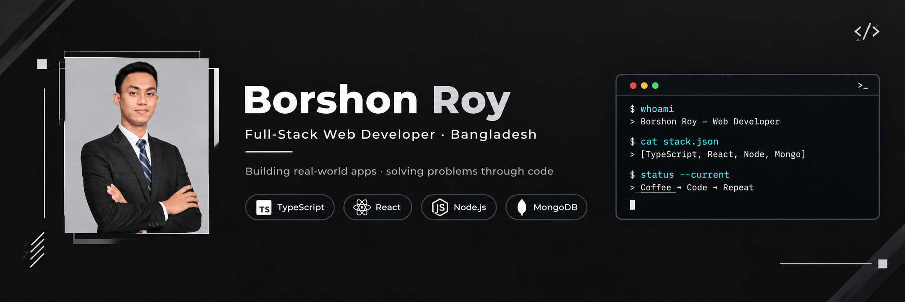

<div align="center">
  
</div>

<div align="center">
  
</div>

---

```bash
$ whoami
> Borshon Roy — Web Developer based in Bangladesh

$ cat about.txt
> Turning ideas into clean, useful, and user-friendly web experiences.
> Building real-world applications, solving problems through code,
> and continuously learning modern web technologies.

$ status --current
> 🌱 Sharpening skills in JavaScript, React & TypeScript
> 💻 Building modern, responsive web applications
> 🧠 Passionate about problem solving and clean architecture
> ☕ Coffee → Code → Repeat
```

---

## 🧰 `Languages & Tools`

<h3 align="center">Programming Languages</h3>
<p align="center">
  
</p>

<h3 align="center">Frontend</h3>
<p align="center">
  
</p>

<h3 align="center">Backend</h3>
<p align="center">
  
</p>

<h3 align="center">Database</h3>
<p align="center">
  
</p>

<h3 align="center">Tools & Platforms</h3>
<p align="center">
  
</p>

---

## 💹 `GITHUB ANALYTICS`

<div align="center">
  <a href="https://github.com/borshon07">
    
  </a>
  <a href="https://github.com/borshon07">
    
  </a>
</div>

<div align="center">
  
</div>

---

## 🧭 `CONTRIBUTION ACTIVITY`

<div align="center">
  
</div>

---

## 🏗️ `What I Build`

<table align="center">
  <tr>
    <td align="center" width="220">
      <h2>🌐</h2>
      <b>Modern Web Apps</b><br/>
      <sub>Fast, responsive, production-ready</sub>
    </td>
    <td align="center" width="220">
      <h2>⚙️</h2>
      <b>REST APIs</b><br/>
      <sub>Clean, scalable backend services</sub>
    </td>
  </tr>
  <tr>
    <td align="center" width="220">
      <h2>📱</h2>
      <b>Responsive UI</b><br/>
      <sub>Pixel-perfect on every device</sub>
    </td>
    <td align="center" width="220">
      <h2>🧩</h2>
      <b>Problem Solving</b><br/>
      <sub>DSA, algorithms & clean logic</sub>
    </td>
  </tr>
</table>

---

## 🕹️ `Contribution Pacman`

<picture>
  <source media="(prefers-color-scheme: dark)" srcset="https://raw.githubusercontent.com/borshon07/borshon07/output/pacman-contribution-graph-dark.svg">
  <source media="(prefers-color-scheme: light)" srcset="https://raw.githubusercontent.com/borshon07/borshon07/output/pacman-contribution-graph.svg">
  
</picture>

---

## 📮 `CONNECT WITH ME`

<div align="center">

<a href="https://www.linkedin.com/in/borshon-roy09">
  
</a>
<a href="https://leetcode.com/u/longshoot09/">
  
</a>
<a href="mailto:borshonroy73@gmail.com">
  
</a>

</div>

---

<div align="center">
  
  <br/><br/>
  🌸 Thanks for visiting my profile!
</div>

<div align="center">
  
</div>
